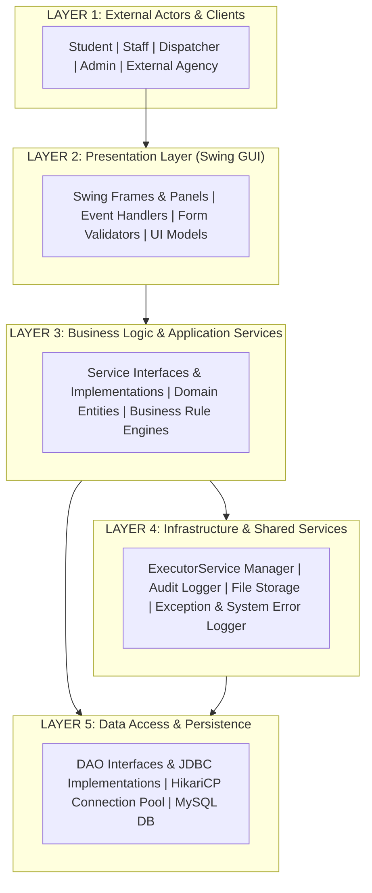

# ARCHITECTURE SPECIFICATION DOCUMENT
## SMART CAMPUS EMERGENCY & RESOURCE CO-ORDINATION SYSTEM

---

## 1. System Architectural Layer Overview

The system is designed following a **Strict 5-Layered Architecture** adhering to clean code standards, separation of concerns, and robust Object-Oriented Design Principles (SOLID).



---

## 2. Core Object-Oriented Architecture & Design Patterns

### 2.1 Object-Oriented Principles Applied
1. **Encapsulation**: Domain models (`User`, `Incident`, `Resource`) hide internal states behind private attributes, providing controlled access via validated getters, setters, and immutable Data Transfer Objects (DTOs).
2. **Abstraction**: Every service and data layer component exposes a behavioral Interface (`IAuthService`, `IIncidentDao`). Callers interact exclusively with interface abstractions without knowledge of JDBC or Swing specifics.
3. **Inheritance**: Common functionality is extracted into base classes:
   - `BaseEntity` (ID, created_at, updated_at)
   - `BasePanel` (Common Swing UI theme methods, event listeners, layout setup)
   - `CampusEmergencyException` (Base hierarchy for custom runtime/checked exceptions)
   - `AbstractJDBCDao<T, ID>` (Generic JDBC CRUD execution, transaction management, connection handling)
4. **Polymorphism**: 
   - Strategy Pattern for **Priority Calculation** (`IPriorityStrategy` implemented by `FirePriorityStrategy`, `MedicalPriorityStrategy`, `ThreatPriorityStrategy`).
   - Strategy Pattern for **Notification Delivery** (`INotificationChannel` implemented by `DashboardNotificationChannel`, `EmailNotificationChannel`, `SMSNotificationChannel`).
   - Factory Pattern for **Exporter** (`IAnalyticsExporter` implemented by `PdfAnalyticsExporter`, `CsvAnalyticsExporter`).
5. **Dependency Separation**: Higher layers depend on lower layer abstractions (Interfaces), instantiated via a Service Registry / Factory pattern. Database operations are decoupled from presentation using DTOs and Service contracts.

---

## 3. Module Architectural Mapping

Below is the exhaustive architectural specification for each of the 16 core system modules.

---

### Module 1: Authentication

* **Responsibility**: Authenticate users, manage active sessions, enforce Role-Based Access Control (RBAC), and manage password security via cryptographic hashing.
* **Architecture Mapping**:
  * **Layer 1**: Student, Staff, Dispatcher, Admin, External Agency actors initiating login.
  * **Layer 2**: `LoginFrame`, `LoginFormPanel`, `SessionView`.
  * **Layer 3**: `IAuthService`, `AuthServiceImpl`, `UserSessionContext`, `RBACValidator`.
  * **Layer 4**: `AuditLogger`, `PasswordHashEngine` (BCrypt wrapper).
  * **Layer 5**: `IUserDao`, `UserDaoImpl` (Queries `users` table).
* **Classes**:
  * `com.smartcampus.ui.auth.LoginFrame` (Extends `JFrame`)
  * `com.smartcampus.service.auth.AuthServiceImpl` (Implements `IAuthService`)
  * `com.smartcampus.security.PasswordHashEngine`
  * `com.smartcampus.model.UserSession` (Encapsulates current user, token, login timestamp)
* **Interfaces**:
  * `com.smartcampus.service.auth.IAuthService`
  * `com.smartcampus.dao.IUserDao`
* **Dependencies**: `IUserDao`, `PasswordHashEngine`, `AuditLogger`, `UserSession`.
* **Inputs**: `LoginCredentialsDTO` (username/email, plain-text password).
* **Outputs**: `UserSession` instance upon success; throws `AuthenticationException` on failure.
* **Database Interaction**: Reads `users` table (`SELECT * FROM users WHERE username = ? OR email = ?`).
* **Error Handling**: Throws `InvalidCredentialsException`, `AccountLockedException`, `DatabaseAccessException`. Logged via `AuditLogger` as failed login attempts.

---

### Module 2: User Registration

* **Responsibility**: Validate registration details for Students and Staff, verify campus IDs, enforce role assignment rules, and create user accounts.
* **Architecture Mapping**:
  * **Layer 1**: Unauthenticated Student / Staff applicants.
  * **Layer 2**: `RegistrationFrame`, `RegistrationFormPanel`.
  * **Layer 3**: `IUserRegistrationService`, `UserRegistrationServiceImpl`.
  * **Layer 4**: `AuditLogger`, `InputSanitizer`, `PasswordHashEngine`.
  * **Layer 5**: `IUserDao`, `UserDaoImpl`.
* **Classes**:
  * `com.smartcampus.ui.auth.RegistrationFrame`
  * `com.smartcampus.service.user.UserRegistrationServiceImpl`
  * `com.smartcampus.model.User` (Extends `BaseEntity`)
* **Interfaces**:
  * `com.smartcampus.service.user.IUserRegistrationService`
  * `com.smartcampus.dao.IUserDao`
* **Dependencies**: `IUserDao`, `PasswordHashEngine`, `InputSanitizer`.
* **Inputs**: `UserRegistrationDTO` (username, email, password, full_name, role, campus_id, phone, department, dorm).
* **Outputs**: `UserDTO` (registered user model sanitized without password hash).
* **Database Interaction**: Inserts into `users` table (`INSERT INTO users (...) VALUES (...)`) within a transaction.
* **Error Handling**: Throws `DuplicateUserException`, `InvalidCampusIDException`, `ValidationException`.

---

### Module 3: User Profile

* **Responsibility**: Manage personal details, emergency medical flags, blood group, dorm/office locations, and emergency contact numbers.
* **Architecture Mapping**:
  * **Layer 1**: Student, Staff, Dispatcher.
  * **Layer 2**: `UserProfilePanel` (Extends `BasePanel`).
  * **Layer 3**: `IUserProfileService`, `UserProfileServiceImpl`.
  * **Layer 4**: `AuditLogger`.
  * **Layer 5**: `IUserProfileDao`, `UserProfileDaoImpl`.
* **Classes**:
  * `com.smartcampus.ui.profile.UserProfilePanel`
  * `com.smartcampus.service.user.UserProfileServiceImpl`
  * `com.smartcampus.model.UserProfile`
* **Interfaces**:
  * `com.smartcampus.service.user.IUserProfileService`
  * `com.smartcampus.dao.IUserProfileDao`
* **Dependencies**: `IUserProfileDao`, `IUserDao`, `AuditLogger`.
* **Inputs**: `UserProfileUpdateDTO` (user_id, phone, medical_alerts, blood_group, emergency_contact, primary_building).
* **Outputs**: Updated `UserProfileDTO`.
* **Database Interaction**: Updates `user_profiles` table (`UPDATE user_profiles SET ... WHERE user_id = ?`).
* **Error Handling**: Throws `ProfileNotFoundException`, `DatabaseAccessException`.

---

### Module 4: Emergency Reporting

* **Responsibility**: Provide one-click SOS and detailed emergency reporting (Fire, Medical, Active Threat, Hazard, Security) with precise location tracking.
* **Architecture Mapping**:
  * **Layer 1**: Student, Staff.
  * **Layer 2**: `EmergencyReportPanel`, `SOSButtonComponent`.
  * **Layer 3**: `IIncidentService`, `IncidentServiceImpl`, `EmergencyPriorityEngine`.
  * **Layer 4**: `AsyncNotificationDispatcher`, `AuditLogger`.
  * **Layer 5**: `IIncidentDao`, `IncidentDaoImpl`.
* **Classes**:
  * `com.smartcampus.ui.emergency.SOSButtonComponent`
  * `com.smartcampus.ui.emergency.EmergencyReportPanel`
  * `com.smartcampus.service.incident.IncidentServiceImpl`
  * `com.smartcampus.model.Incident` (Extends `BaseEntity`)
* **Interfaces**:
  * `com.smartcampus.service.incident.IIncidentService`
  * `com.smartcampus.dao.IIncidentDao`
* **Dependencies**: `IIncidentDao`, `EmergencyPriorityEngine`, `AsyncNotificationDispatcher`, `AuditLogger`.
* **Inputs**: `EmergencyReportDTO` (reporter_id, incident_type, building, floor, room, description, casualty_count, hazard_level).
* **Outputs**: `IncidentDTO` (containing generated incident ID, calculated initial priority, status `REPORTED`).
* **Database Interaction**: Inserts into `incidents` table.
* **Error Handling**: Throws `InvalidIncidentDataException`, `EmergencyDispatchFailedException`.

---

### Module 5: Photo/Video Attachment

* **Responsibility**: Upload, sanitize, store, and link photo/video media evidence (PNG, JPG, MP4) to reported incidents.
* **Architecture Mapping**:
  * **Layer 1**: Student, Staff, Dispatcher.
  * **Layer 2**: `FileAttachmentComponent`, `MediaPreviewDialog`.
  * **Layer 3**: `IAttachmentService`, `AttachmentServiceImpl`.
  * **Layer 4**: `FileStorageManager` (Disk writer, SHA-256 calculator, Mime-Type validator).
  * **Layer 5**: `IAttachmentDao`, `AttachmentDaoImpl`.
* **Classes**:
  * `com.smartcampus.ui.components.FileAttachmentComponent`
  * `com.smartcampus.service.attachment.AttachmentServiceImpl`
  * `com.smartcampus.infra.storage.FileStorageManager`
  * `com.smartcampus.model.IncidentAttachment`
* **Interfaces**:
  * `com.smartcampus.service.attachment.IAttachmentService`
  * `com.smartcampus.dao.IAttachmentDao`
* **Dependencies**: `IAttachmentDao`, `FileStorageManager`.
* **Inputs**: `AttachmentUploadDTO` (incident_id, file_name, byte_content/file_stream, mime_type, file_size).
* **Outputs**: `AttachmentDTO` (file_id, relative_storage_path, sha256_hash).
* **Database Interaction**: Inserts file metadata into `incident_attachments` table.
* **Error Handling**: Throws `InvalidFileTypeException`, `FileLimitExceededException`, `StorageIOException`.

---

### Module 6: Emergency Priority Calculation

* **Responsibility**: Compute dynamic incident priority scores using algorithmic weighting of severity, casualty count, hazard level, and building vulnerability.
* **Architecture Mapping**:
  * **Layer 1**: Triggered automatically by Layer 3 (IncidentService) or Dispatcher override.
  * **Layer 2**: `PriorityScoreBadgeComponent` (Visual indicator).
  * **Layer 3**: `EmergencyPriorityEngine`, `IPriorityStrategy` implementations (`FirePriorityStrategy`, `MedicalPriorityStrategy`, `ThreatPriorityStrategy`, `DefaultPriorityStrategy`).
  * **Layer 4**: Logging service.
  * **Layer 5**: Read-only building vulnerability lookup from `buildings` table.
* **Classes**:
  * `com.smartcampus.service.priority.EmergencyPriorityEngine`
  * `com.smartcampus.service.priority.FirePriorityStrategy` (Implements `IPriorityStrategy`)
  * `com.smartcampus.service.priority.ThreatPriorityStrategy` (Implements `IPriorityStrategy`)
* **Interfaces**:
  * `com.smartcampus.service.priority.IPriorityStrategy`
* **Dependencies**: Building vulnerability dataset / DAO.
* **Inputs**: `PriorityInputDTO` (incident_type, casualties, hazard_level, building_vulnerability_score).
* **Outputs**: Calculated `double priorityScore` (0.00 - 100.00).
* **Database Interaction**: None directly (Strategy logic executed in memory).
* **Error Handling**: Fallback to `DefaultPriorityStrategy` if unknown incident type provided.

---

### Module 7: Incident Management

* **Responsibility**: Manage lifecycle state transitions (`REPORTED` $\rightarrow$ `TRIAGED` $\rightarrow$ `DISPATCHED` $\rightarrow$ `IN_PROGRESS` $\rightarrow$ `RESOLVED` $\rightarrow$ `CLOSED` $\rightarrow$ `ESCALATED`) and dispatcher management console.
* **Architecture Mapping**:
  * **Layer 1**: Dispatcher, Admin, External Emergency Agency.
  * **Layer 2**: `DispatcherDashboardFrame`, `IncidentManagementPanel`, `IncidentDetailDialog`.
  * **Layer 3**: `IIncidentManagementService`, `IncidentManagementServiceImpl`, `IncidentStateMachine`.
  * **Layer 4**: `AuditLogger`, `ScheduledExecutorService` (Auto-escalation check).
  * **Layer 5**: `IIncidentDao`, `IncidentDaoImpl`.
* **Classes**:
  * `com.smartcampus.ui.dispatcher.DispatcherDashboardFrame`
  * `com.smartcampus.service.incident.IncidentManagementServiceImpl`
  * `com.smartcampus.service.incident.IncidentStateMachine`
* **Interfaces**:
  * `com.smartcampus.service.incident.IIncidentManagementService`
  * `com.smartcampus.dao.IIncidentDao`
* **Dependencies**: `IIncidentDao`, `IResourceAllocationService`, `AuditLogger`, `AsyncNotificationDispatcher`.
* **Inputs**: `IncidentStatusUpdateDTO` (incident_id, target_status, dispatcher_notes, priority_override).
* **Outputs**: `IncidentDTO` with updated status, timeline event record.
* **Database Interaction**: Updates `incidents` table status and inserts into `incident_timeline` table.
* **Error Handling**: Throws `InvalidStateTransitionException`, `IncidentNotFoundException`.

---

### Module 8: Resource Management

* **Responsibility**: Maintain master catalog of physical emergency resources (Ambulances, AEDs, Fire Extinguishers, First Aid Kits, Vehicles) and track operational status.
* **Architecture Mapping**:
  * **Layer 1**: Dispatcher, Admin.
  * **Layer 2**: `ResourceManagementPanel`, `ResourceInventoryTable`.
  * **Layer 3**: `IResourceService`, `ResourceServiceImpl`.
  * **Layer 4**: `AuditLogger`.
  * **Layer 5**: `IResourceDao`, `ResourceDaoImpl`.
* **Classes**:
  * `com.smartcampus.ui.admin.ResourceManagementPanel`
  * `com.smartcampus.service.resource.ResourceServiceImpl`
  * `com.smartcampus.model.Resource` (Extends `BaseEntity`)
* **Interfaces**:
  * `com.smartcampus.service.resource.IResourceService`
  * `com.smartcampus.dao.IResourceDao`
* **Dependencies**: `IResourceDao`, `AuditLogger`.
* **Inputs**: `ResourceDTO` (resource_name, resource_type, status, location_building, last_inspected).
* **Outputs**: `List<ResourceDTO>`, updated `ResourceDTO`.
* **Database Interaction**: CRUD operations on `resources` table.
* **Error Handling**: Throws `ResourceNotFoundException`, `DuplicateResourceException`.

---

### Module 9: Responder Management

* **Responsibility**: Manage personnel emergency responders (Campus Security, Medical Personnel, Fire Safety Officers) and their real-time duty status.
* **Architecture Mapping**:
  * **Layer 1**: Dispatcher, Admin.
  * **Layer 2**: `ResponderRosterPanel`, `ResponderStatusBadge`.
  * **Layer 3**: `IResponderService`, `ResponderServiceImpl`.
  * **Layer 4**: `AuditLogger`.
  * **Layer 5**: `IResponderDao`, `ResponderDaoImpl`.
* **Classes**:
  * `com.smartcampus.ui.dispatcher.ResponderRosterPanel`
  * `com.smartcampus.service.responder.ResponderServiceImpl`
  * `com.smartcampus.model.Responder`
* **Interfaces**:
  * `com.smartcampus.service.responder.IResponderService`
  * `com.smartcampus.dao.IResponderDao`
* **Dependencies**: `IResponderDao`, `AuditLogger`.
* **Inputs**: `ResponderDTO` (full_name, specialization, phone, status: `ON_DUTY`/`DISPATCHED`/`OFF_DUTY`).
* **Outputs**: `ResponderDTO`, `List<ResponderDTO>`.
* **Database Interaction**: Queries and updates `responders` table.
* **Error Handling**: Throws `ResponderNotFoundException`, `InvalidStatusException`.

---

### Module 10: Resource Allocation

* **Responsibility**: Match incidents with optimal available resources/responders and lock allocation atomically to prevent double-booking.
* **Architecture Mapping**:
  * **Layer 1**: Dispatcher.
  * **Layer 2**: `ResourceAllocationDialog`, `AllocationMatrixPanel`.
  * **Layer 3**: `IResourceAllocationService`, `ResourceAllocationServiceImpl`, `AllocationRecommendationEngine`.
  * **Layer 4**: Database Transaction Manager, `AuditLogger`.
  * **Layer 5**: `IResourceAllocationDao`, `ResourceAllocationDaoImpl`, `IResourceDao`, `IResponderDao`.
* **Classes**:
  * `com.smartcampus.ui.dispatcher.ResourceAllocationDialog`
  * `com.smartcampus.service.allocation.ResourceAllocationServiceImpl`
  * `com.smartcampus.model.ResourceAllocation`
* **Interfaces**:
  * `com.smartcampus.service.allocation.IResourceAllocationService`
  * `com.smartcampus.dao.IResourceAllocationDao`
* **Dependencies**: `IResourceAllocationDao`, `IResourceDao`, `IResponderDao`, `IIncidentDao`, `AuditLogger`.
* **Inputs**: `AllocationRequestDTO` (incident_id, list of resource_ids, list of responder_ids).
* **Outputs**: `AllocationResultDTO` (allocation_id, timestamp, status).
* **Database Interaction**: Performs atomic MySQL transaction:
  1. `UPDATE resources SET current_status = 'IN_USE' WHERE id IN (...) AND current_status = 'AVAILABLE'`
  2. `UPDATE responders SET status = 'DISPATCHED' WHERE id IN (...)`
  3. `INSERT INTO resource_allocations (...)`
* **Error Handling**: Throws `ResourceUnavailableException` (if atomic update count mismatch occurs), rolls back transaction.

---

### Module 11: Emergency Tracking

* **Responsibility**: Provide live status updates, incident progress timeline, and responder ETA estimation.
* **Architecture Mapping**:
  * **Layer 1**: Student, Staff, Dispatcher, Admin.
  * **Layer 2**: `IncidentTrackerPanel`, `TimelineWidget`.
  * **Layer 3**: `IIncidentTrackingService`, `IncidentTrackingServiceImpl`.
  * **Layer 4**: `ScheduledExecutorService` (Periodic background poller / push updates).
  * **Layer 5**: `IIncidentDao`, `IIncidentTimelineDao`.
* **Classes**:
  * `com.smartcampus.ui.tracking.IncidentTrackerPanel`
  * `com.smartcampus.service.tracking.IncidentTrackingServiceImpl`
  * `com.smartcampus.model.IncidentTimelineEvent`
* **Interfaces**:
  * `com.smartcampus.service.tracking.IIncidentTrackingService`
  * `com.smartcampus.dao.IIncidentTimelineDao`
* **Dependencies**: `IIncidentDao`, `IIncidentTimelineDao`.
* **Inputs**: `incident_id`.
* **Outputs**: `IncidentTrackingDetailsDTO` (current status, event timeline, allocated responders, ETA).
* **Database Interaction**: Reads `incidents` and `incident_timeline` join queries.
* **Error Handling**: Throws `IncidentNotFoundException`.

---

### Module 12: Notifications

* **Responsibility**: Dispatch asynchronous campus-wide announcements and targeted responder alerts using Java `ExecutorService`.
* **Architecture Mapping**:
  * **Layer 1**: All Users (Receivers).
  * **Layer 2**: `NotificationAlertBanner`, `SystemTrayNotifier`.
  * **Layer 3**: `INotificationService`, `NotificationServiceImpl`.
  * **Layer 4**: `ExecutorServiceManager` (Thread pool management), `INotificationChannel` strategy family (`DashboardNotificationChannel`, `EmailNotificationChannel`, `SMSNotificationChannel`).
  * **Layer 5**: `INotificationDao`, `NotificationDaoImpl`.
* **Classes**:
  * `com.smartcampus.infra.threadpool.ExecutorServiceManager`
  * `com.smartcampus.service.notification.NotificationServiceImpl`
  * `com.smartcampus.service.notification.DashboardNotificationChannel`
* **Interfaces**:
  * `com.smartcampus.service.notification.INotificationService`
  * `com.smartcampus.service.notification.INotificationChannel`
  * `com.smartcampus.dao.INotificationDao`
* **Dependencies**: `ExecutorServiceManager`, `INotificationDao`, `INotificationChannel`.
* **Inputs**: `NotificationPayloadDTO` (recipient_group, title, body, priority_level).
* **Outputs**: `AsyncFuture<NotificationDeliveryResult>`.
* **Database Interaction**: Inserts alerts into `notifications` table for persistence.
* **Error Handling**: Handles thread execution rejection via `RejectedExecutionHandler`, logs failures to `SystemErrorLogger`.

---

### Module 13: Admin Dashboard

* **Responsibility**: System monitoring, user administration, master lookup configurations, and system health status.
* **Architecture Mapping**:
  * **Layer 1**: Administrator.
  * **Layer 2**: `AdminMainDashboardFrame`, `UserManagementPanel`, `SystemHealthPanel`.
  * **Layer 3**: `IAdminService`, `AdminServiceImpl`.
  * **Layer 4**: `SystemErrorHandler`, `AuditLogger`, HikariCP `HikariPoolMXBean` (Pool metrics).
  * **Layer 5**: Access to all DAOs.
* **Classes**:
  * `com.smartcampus.ui.admin.AdminMainDashboardFrame`
  * `com.smartcampus.service.admin.AdminServiceImpl`
* **Interfaces**:
  * `com.smartcampus.service.admin.IAdminService`
* **Dependencies**: `IUserDao`, `IIncidentDao`, `IResourceDao`, `HikariDataSourceManager`, `AuditLogger`.
* **Inputs**: Administrative commands (User enable/disable, system parameters).
* **Outputs**: `AdminDashboardSummaryDTO` (active user counts, system error count, DB connection pool health, total incidents).
* **Database Interaction**: Aggregated counts across multiple tables.
* **Error Handling**: Throws `AdminOperationException`, `UnauthorizedException`.

---

### Module 14: Analytics

* **Responsibility**: Generate statistical reports, calculate mean response times, identify incident hotspots, and export report data to CSV/PDF.
* **Architecture Mapping**:
  * **Layer 1**: Dispatcher, Admin.
  * **Layer 2**: `AnalyticsDashboardPanel`, `ChartPanelComponent`.
  * **Layer 3**: `IAnalyticsService`, `AnalyticsServiceImpl`, `IAnalyticsExporter` implementations (`CsvAnalyticsExporter`, `PdfAnalyticsExporter`).
  * **Layer 4**: Storage & Export file generation.
  * **Layer 5**: `IAnalyticsDao`, `AnalyticsDaoImpl`.
* **Classes**:
  * `com.smartcampus.ui.analytics.AnalyticsDashboardPanel`
  * `com.smartcampus.service.analytics.AnalyticsServiceImpl`
  * `com.smartcampus.service.analytics.CsvAnalyticsExporter`
* **Interfaces**:
  * `com.smartcampus.service.analytics.IAnalyticsService`
  * `com.smartcampus.service.analytics.IAnalyticsExporter`
  * `com.smartcampus.dao.IAnalyticsDao`
* **Dependencies**: `IAnalyticsDao`, `IAnalyticsExporter`.
* **Inputs**: `AnalyticsFilterDTO` (date_range_start, date_range_end, incident_type, building_filter).
* **Outputs**: `AnalyticsReportDTO` (metrics, datasets) or exported file reference.
* **Database Interaction**: Executes SQL analytical aggregate queries (`AVG(TIMESTAMPDIFF(SECOND, reported_at, resolved_at))`, `COUNT(*)` GROUP BY `location_building`).
* **Error Handling**: Throws `ExportFailedException`, `NoDataFoundException`.

---

### Module 15: Audit Logging

* **Responsibility**: Provide an immutable record of system security events, dispatcher triage decisions, user logins, and resource changes.
* **Architecture Mapping**:
  * **Layer 1**: Read-only inspection by Admin.
  * **Layer 2**: `AuditLogViewerPanel`.
  * **Layer 3**: `IAuditLogService`, `AuditLogServiceImpl`.
  * **Layer 4**: `AuditLogger` (Singleton shared infrastructure service).
  * **Layer 5**: `IAuditLogDao`, `AuditLogDaoImpl`.
* **Classes**:
  * `com.smartcampus.infra.logging.AuditLogger`
  * `com.smartcampus.service.audit.AuditLogServiceImpl`
  * `com.smartcampus.model.AuditLog` (Immutable model)
* **Interfaces**:
  * `com.smartcampus.service.audit.IAuditLogService`
  * `com.smartcampus.dao.IAuditLogDao`
* **Dependencies**: `IAuditLogDao`.
* **Inputs**: `user_id`, `action_name`, `details_json`, `ip_address/client_id`.
* **Outputs**: Immutable `AuditLog` entry persisted; `List<AuditLogDTO>` for viewer.
* **Database Interaction**: `INSERT INTO audit_logs` (Note: No `UPDATE` or `DELETE` methods exposed in `IAuditLogDao` to enforce immutability).
* **Error Handling**: Written to fallback local append-only text log file if DB insertion fails.

---

### Module 16: System Error Logging

* **Responsibility**: Centralized exception handling, stack trace logging, database error recording, and administrator diagnostic alerts.
* **Architecture Mapping**:
  * **Layer 1**: Internal system processes.
  * **Layer 2**: Global `EDTUncaughtExceptionHandler` for Swing UI thread.
  * **Layer 3**: Exception interceptors.
  * **Layer 4**: `SystemErrorHandler` (SLF4J/Logback integration), `UnhandledExceptionLogger`.
  * **Layer 5**: `ISystemErrorLogDao`, `SystemErrorLogDaoImpl`.
* **Classes**:
  * `com.smartcampus.infra.logging.SystemErrorHandler`
  * `com.smartcampus.infra.logging.EDTUncaughtExceptionHandler`
  * `com.smartcampus.model.SystemErrorLog`
* **Interfaces**:
  * `com.smartcampus.dao.ISystemErrorLogDao`
* **Dependencies**: `ISystemErrorLogDao`, SLF4J Logger.
* **Inputs**: `Throwable exception`, `String contextMessage`, `String componentName`.
* **Outputs**: Formatted log file entry + `system_error_logs` DB record.
* **Database Interaction**: Inserts into `system_error_logs` table (`error_type`, `stack_trace`, `timestamp`).
* **Error Handling**: Self-contained error logging; if DB logging fails, falls back to `stderr` and rolling disk file (`logs/error.log`).

---

## 4. Package Structure Blueprint

```
com.smartcampus
├── config
│   ├── DatabaseConfig.java
│   └── AppConfig.java
├── model
│   ├── entity
│   │   ├── BaseEntity.java
│   │   ├── User.java
│   │   ├── Incident.java
│   │   ├── Resource.java
│   │   ├── Responder.java
│   │   ├── ResourceAllocation.java
│   │   ├── AuditLog.java
│   │   └── SystemErrorLog.java
│   └── dto
│       ├── LoginCredentialsDTO.java
│       ├── EmergencyReportDTO.java
│       └── AllocationRequestDTO.java
├── dao
│   ├── api
│   │   ├── IUserDao.java
│   │   ├── IIncidentDao.java
│   │   ├── IResourceDao.java
│   │   └── IAuditLogDao.java
│   └── impl
│       ├── AbstractJDBCDao.java
│       ├── UserDaoImpl.java
│       ├── IncidentDaoImpl.java
│       └── ResourceDaoImpl.java
├── service
│   ├── api
│   │   ├── IAuthService.java
│   │   ├── IIncidentService.java
│   │   └── IResourceAllocationService.java
│   ├── impl
│   │   ├── AuthServiceImpl.java
│   │   ├── IncidentServiceImpl.java
│   │   └── ResourceAllocationServiceImpl.java
│   └── priority
│       ├── IPriorityStrategy.java
│       ├── EmergencyPriorityEngine.java
│       ├── FirePriorityStrategy.java
│       └── MedicalPriorityStrategy.java
├── infra
│   ├── db
│   │   └── HikariDataSourceManager.java
│   ├── threadpool
│   │   └── ExecutorServiceManager.java
│   ├── storage
│   │   └── FileStorageManager.java
│   └── logging
│       ├── AuditLogger.java
│       └── SystemErrorHandler.java
├── exception
│   ├── CampusEmergencyException.java
│   ├── AuthenticationException.java
│   ├── ResourceUnavailableException.java
│   └── DatabaseAccessException.java
└── ui
    ├── base
    │   ├── BaseFrame.java
    │   └── BasePanel.java
    ├── auth
    │   ├── LoginFrame.java
    │   └── RegistrationFrame.java
    ├── emergency
    │   ├── SOSButtonComponent.java
    │   └── EmergencyReportPanel.java
    ├── dispatcher
    │   ├── DispatcherDashboardFrame.java
    │   └── ResourceAllocationDialog.java
    └── admin
        └── AdminMainDashboardFrame.java
```
