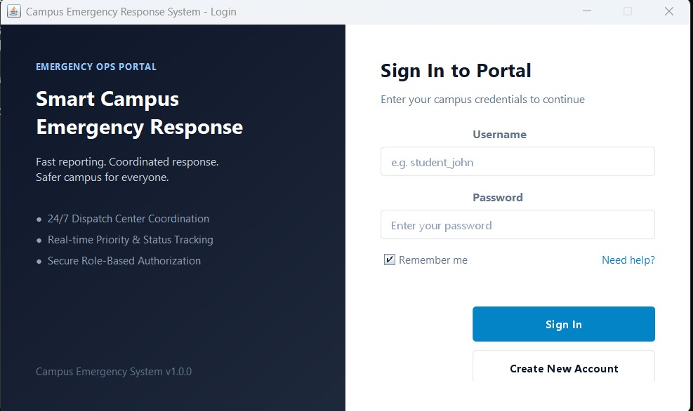
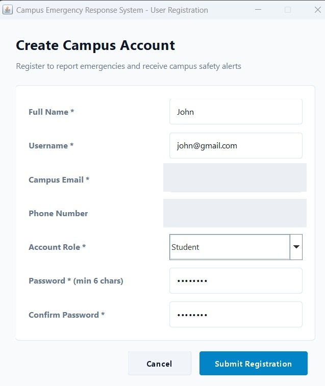
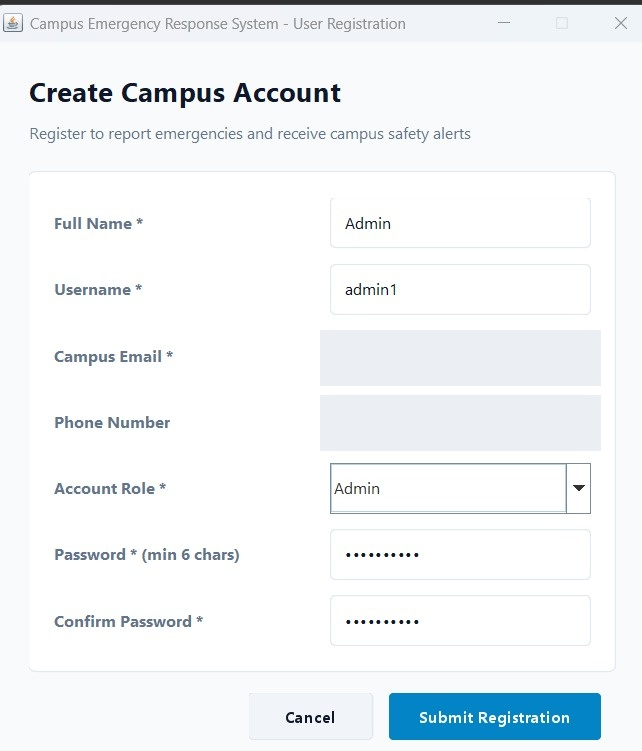
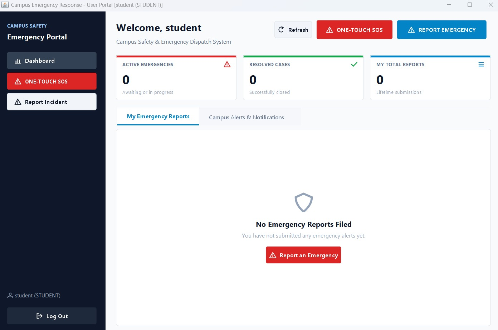
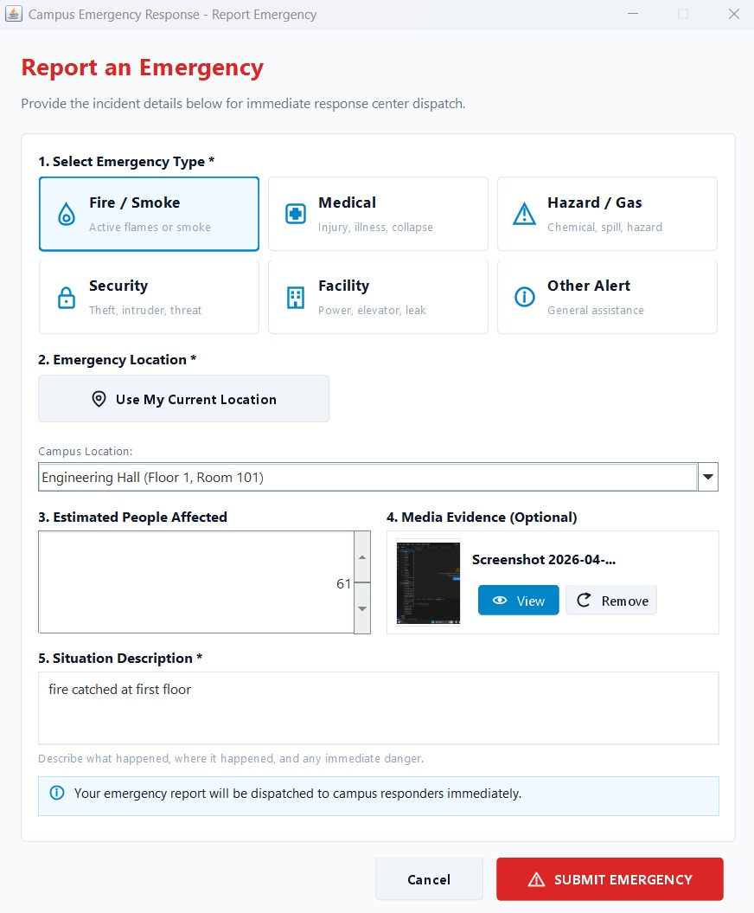
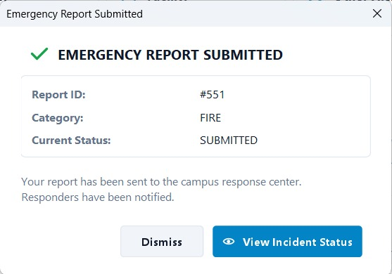
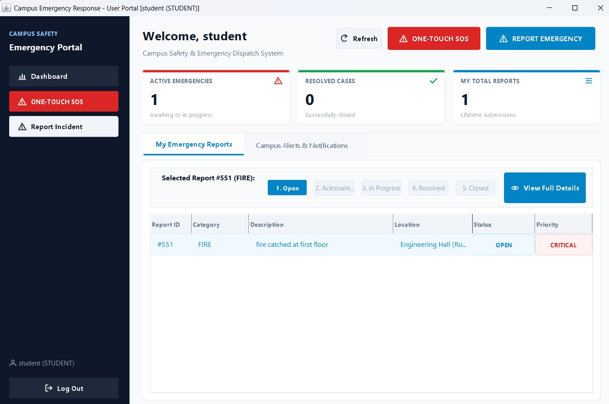
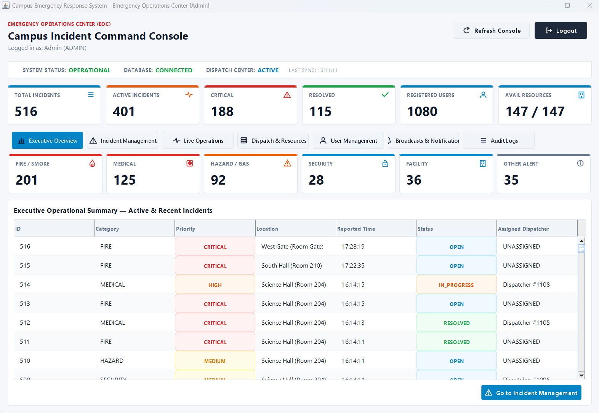
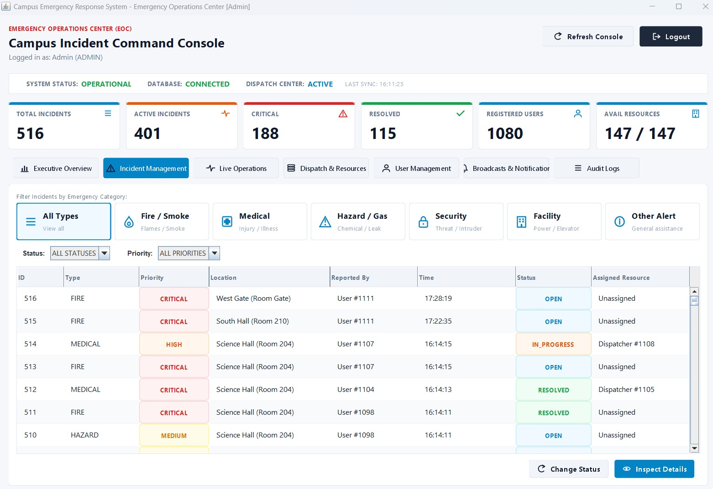
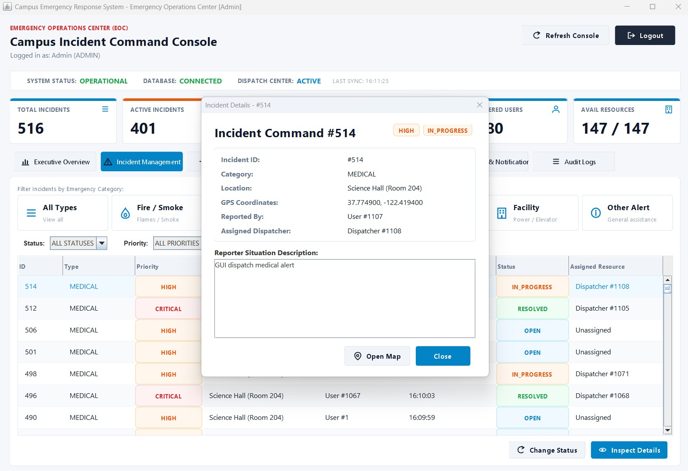

# Campus Emergency Response System

An enterprise-grade, **100% Java Swing Desktop Application** designed for rapid campus emergency reporting, incident management, responder dispatch, and real-time operations tracking.

---

## 📋 Table of Contents
- [Architecture & Tech Stack](#architecture--tech-stack)
- [Prerequisites](#prerequisites)
- [Database Setup Instructions](#database-setup-instructions)
- [Configuring Database Credentials](#configuring-database-credentials)
- [Building the Executable JAR](#building-the-executable-jar)
- [Launching the Java Swing Application](#launching-the-java-swing-application)
- [User Roles & Key Features](#user-roles--key-features)
  - [USER Portal](#user-portal)
  - [ADMIN Operations Console](#admin-operations-console)
- [Location Detection & Manual Fallback](#location-detection--manual-fallback)
- [Running Unit & Integration Tests](#running-unit--integration-tests)
- [Project Output Screenshots](#project-output-screenshots)
  - [SURAKSH Safety Evaluation Output](#suraksh-safety-evaluation-output)

---

## 🏗 Architecture & Tech Stack

The application is built using a clean 5-layer Java desktop architecture:
- **Language & Runtime**: Java 24 (required by `pom.xml` via Maven compiler release 24)
- **User Interface**: Pure Java Swing / AWT (Custom modern UI components with `ModernCardPanel`, `MetricCard`, `ModernTable`, `StatusBadge`, `PriorityBadge`, and `VectorIcon`)
- **Persistence**: JDBC with **HikariCP** Connection Pooling & **MySQL 8.0**
- **Build & Dependency Management**: Apache Maven
- **External Integration**: OpenStreetMap / Nominatim HTTPS API for geolocation lookup and map visualization

> **Note**: The application is 100% standalone Java Swing desktop app. It does **not** launch or depend on any localhost HTTP web server or browser UI.

---

## ⚙ Prerequisites

Before building and running the project, ensure you have installed:
- **Java Development Kit (JDK)**: JDK 24 or a compatible JDK that supports Java release 24
- **Apache Maven**: Version 3.8+
- **MySQL Database Server**: Version 8.0+

---

## 🗄 Database Setup Instructions

1. **Start MySQL Service** on your machine.
2. **Initialize the schema** by running `database/schema.sql`:
   ```bash
   mysql -u root -p < database/schema.sql
   ```
   This creates `campus_emergency_db` and the tables required by the application, including users, roles, locations, emergency reports and incidents, resources, responders, and system logs.
3. **Load the optional development seed data**:
   ```bash
   mysql -u root -p campus_emergency_db < database/seed.sql
   ```
   The seed script adds the documented roles, demo users, campus locations, a responder, resources, and an initial system log. It is intended for development/demo use.

---

## 🔐 Configuring Database Credentials

To keep credentials secure and out of source control, set environment variables on your system or run session:

### Environment Variables (Recommended):
- `DB_URL`: `jdbc:mysql://localhost:3306/campus_emergency_db?useSSL=false&serverTimezone=UTC`
- `DB_USER`: `root` (or your database user)
- `DB_PASS`: `your_password`

#### PowerShell Example:
```powershell
$env:DB_URL="jdbc:mysql://localhost:3306/campus_emergency_db"
$env:DB_USER="root"
$env:DB_PASS="YourSecurePassword"
```

#### Linux/macOS Example:
```bash
export DB_URL="jdbc:mysql://localhost:3306/campus_emergency_db"
export DB_USER="root"
export DB_PASS="YourSecurePassword"
```

---

## 🔨 Building the Executable JAR

Compile the source code and package the shaded executable JAR without running tests:

```bash
mvn clean package -DskipTests
```

The output executable JAR file will be generated at:
`target/campus-emergency-system-1.0.0.jar`

---

## 🚀 Launching the Java Swing Application

Launch the desktop application directly using Java:

```bash
java -jar target/campus-emergency-system-1.0.0.jar
```

The Java Swing `LoginFrame` will open on your desktop.

---

## 👥 User Roles & Key Features

The application operates with two primary access levels: **USER** and **ADMIN**.

### 1. USER Portal
Designed for Students, Staff, and Campus Community Members:
- **Report Emergency**: File incidents across 6 categories (*Fire / Smoke*, *Medical*, *Hazard / Gas*, *Security*, *Facility*, *Other Alert*).
- **One-Touch SOS**: Broadcast instant high-priority distress signals to Campus Security and First Responders.
- **Track Incidents**: View real-time status progression timelines (*OPEN* ➔ *IN_PROGRESS* ➔ *RESOLVED* ➔ *CLOSED*) for reported emergencies.
- **Campus Alerts & Notifications**: Receive real-time announcements broadcast by the Emergency Operations Center.
- **User Profile**: View user account details and credentials.

### 2. ADMIN Operations Console
Designed for Emergency Operations Center (EOC) Command & Dispatchers:
- **1. Executive Overview**: High-level KPI metrics, active incident breakdown, category distribution counters, and overall operational status.
- **2. Incident Management**: Filter, search, inspect detailed emergency reports, and update operational statuses.
- **3. Live Operations**: Real-time incident command monitoring, GPS coordinate inspection, and direct OpenStreetMap links.
- **4. Dispatch & Resources**: Assign emergency responders/units to active incidents, manage resource statuses (*AVAILABLE*, *DISPATCHED*, *MAINTENANCE*), and release resources upon resolution.
- **5. User Management**: Search, view, and inspect all registered campus users and their roles.
- **6. Broadcasts & Notifications**: Broadcast emergency announcements across selected target audiences (*All Users*, *Dispatched Responders*, *Campus Community*).
- **7. Audit Logs**: Track system event logs, security actions, status updates, and user logins.
- **8. System Settings**: Configure console auto-refresh intervals, auto-dispatch recommendation options, and inspect HikariCP database pool health metrics.

---

## 📍 Location Detection & Manual Fallback

- **GPS Location Detection**: Captures device/network GPS coordinates when reporting an emergency.
- **OpenStreetMap Integration**: External HTTPS calls to Nominatim/OpenStreetMap provide location reverse-geocoding and direct map links for dispatchers.
- **Manual Campus Location Selection**: If location detection is denied or unavailable, users can select specific campus buildings, floors, and room numbers from a dropdown list. Location detection failures **never block** emergency report submission.

---

## 🧪 Running Unit & Integration Tests

Run the full suite of automated unit and integration tests:

```bash
mvn clean test
```

---

## 📸 Project Output Screenshots

The following screenshots show the implemented Campus Emergency Response System flows. Personal phone numbers and email addresses visible in the original registration captures have been redacted for public repository use.

### Authentication and account setup

#### Login

The secure portal entry screen for campus users and administrators.



#### Student registration

Student account creation with campus identity and role selection.



#### Administrator registration

Administrator account creation with the administrator role selected.



### Student emergency workflow

#### Student dashboard

The student portal dashboard showing emergency actions, report counters, and notifications.



#### Report an emergency

The emergency report form for selecting an incident category, location, affected people, evidence, and description.



#### Report submission confirmation

Confirmation shown after an emergency report is submitted to the campus response center.



#### Incident tracking

The student view of a submitted report and its operational status progression.



### Administrator operations

#### Executive administrator dashboard

The Emergency Operations Center overview with system status, incident metrics, category totals, and recent incidents.



#### Incident management

The administrator incident-management view for filtering, prioritizing, and updating emergency records.



#### Incident details

Detailed incident inspection showing category, location, reporter, dispatcher, status, and situation description.


